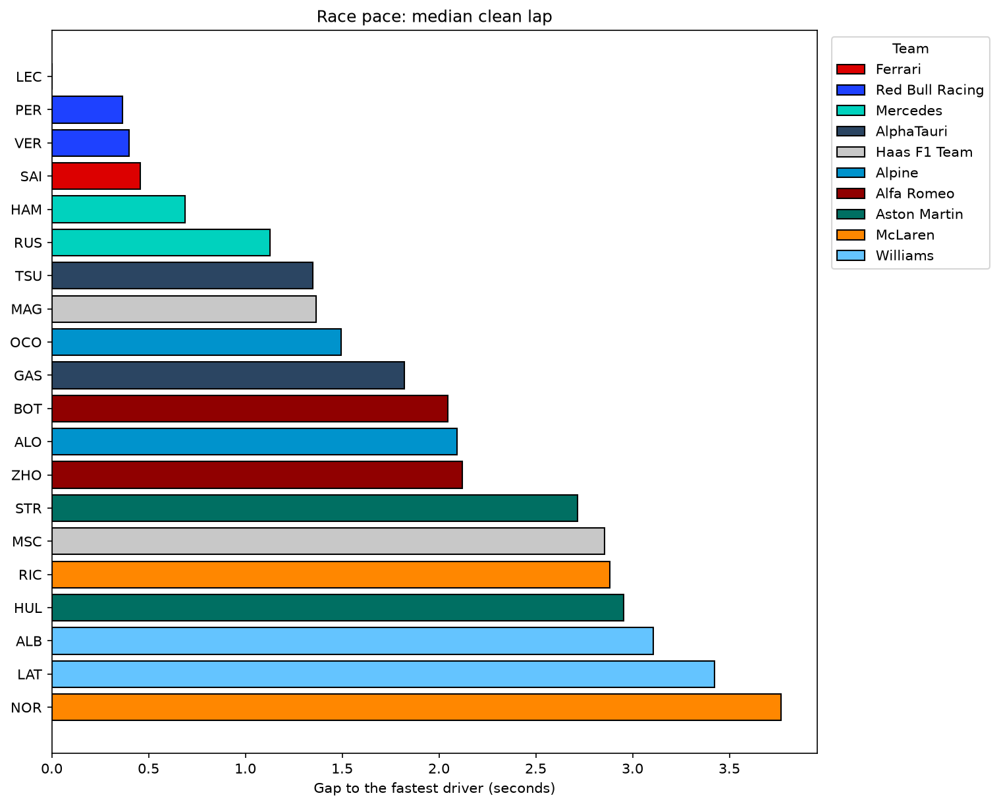
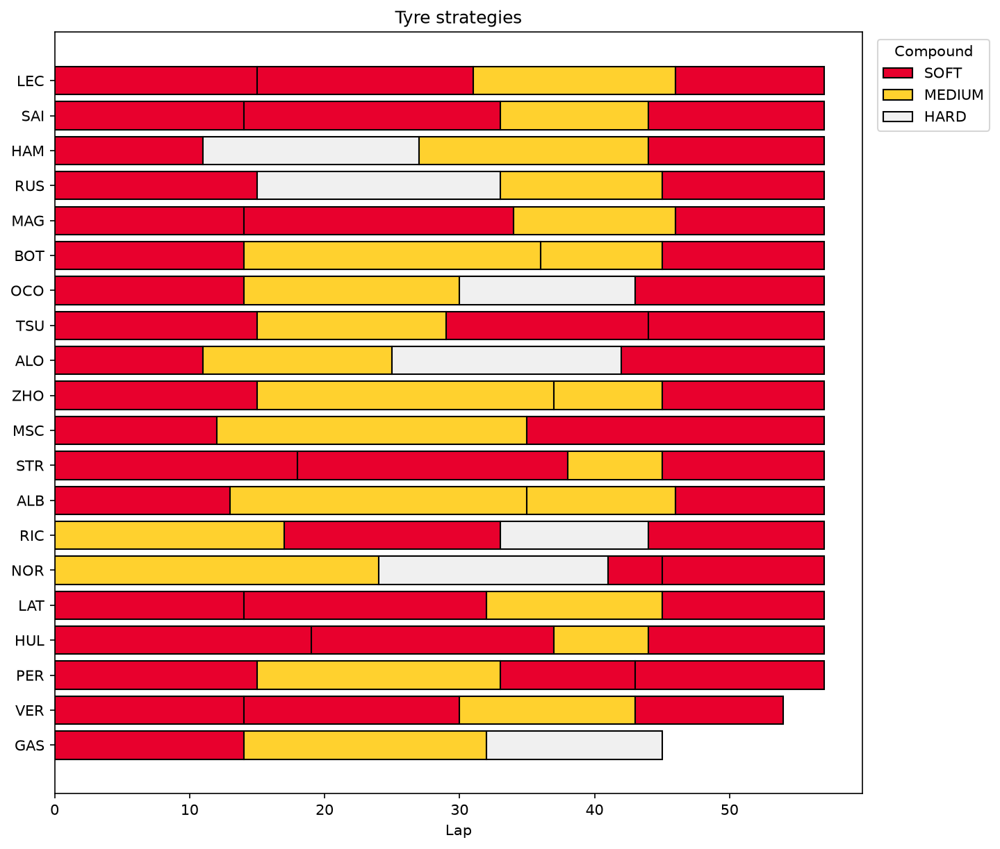
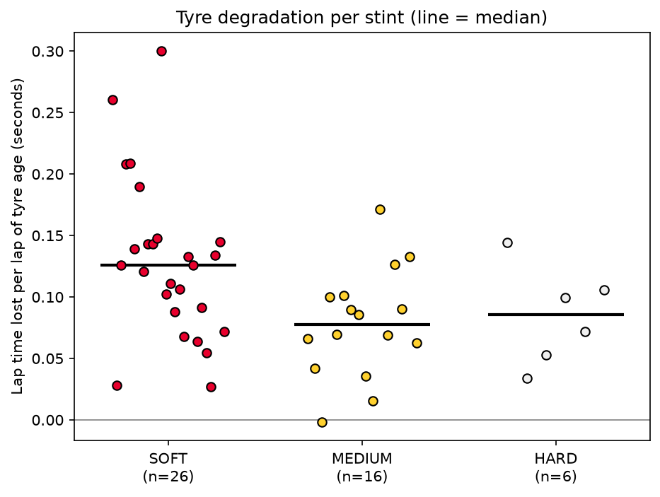
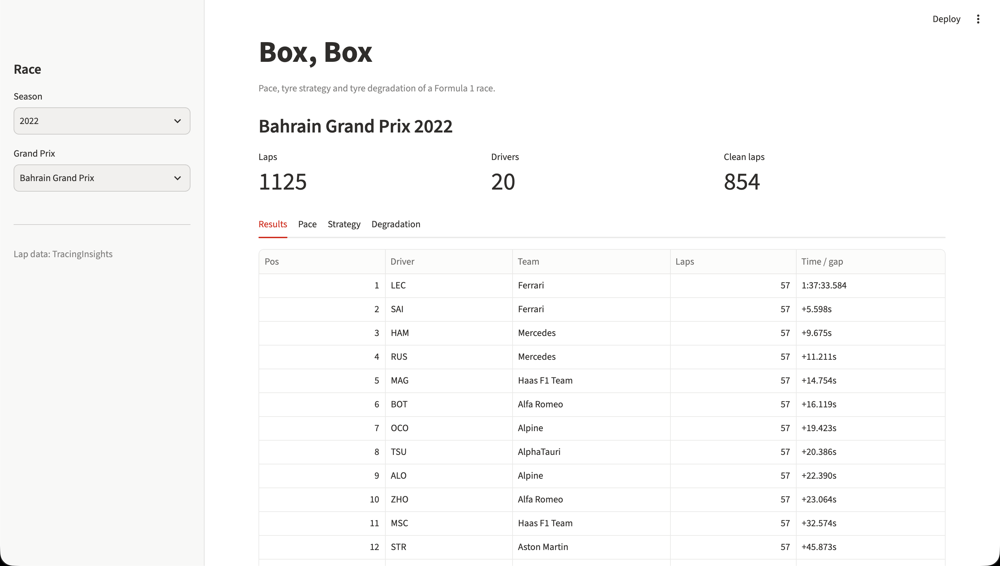

# Box, Box: lap-by-lap analysis of Formula 1 races

Individual project for *Coding for Data Science and Data Management*
(University of Milan), by Aziz Mejri.

Box, Box downloads the lap times of a Formula 1 race, cleans them, and
answers three questions about it:

1. **Pace:** who was fastest over the whole race?
2. **Tyre strategy:** who stopped when, and on which compounds?
3. **Tyre degradation:** how much lap time does a set of tyres lose per lap of age?

It works on the races of the 2022 to 2026 seasons. The notebooks and the
results below use the **Bahrain 2022** Grand Prix (a dry race) as the worked
example. A small web app (see [Web app](#web-app)) lets you explore any other
race without writing code.

## Example results: Bahrain 2022

**1. Pace.** LEC had the best median clean lap (97.693 s). PER (+0.36 s),
VER (+0.40 s) and SAI (+0.46 s) were next; NOR was last, 3.77 s behind.
Teams are coloured, so teammates can be compared at a glance.



**2. Strategy.** The 20 drivers used 9 different compound sequences. The most
common was `SOFT-SOFT-MEDIUM-SOFT` (7 drivers). 18 drivers started on SOFT and
19 finished on it; 18 made three stops. Each block of the chart is one stint.



**3. Degradation.** SOFT lost about 0.126 s per lap of tyre age (median of 26
stints), MEDIUM about 0.077 s (16 stints) and HARD about 0.086 s (6 stints).
SOFT wears fastest; MEDIUM and HARD are too close to rank. The stints vary a
lot, so a single SOFT stint can wear less than a MEDIUM one.



## Data

The data come from [TracingInsights](https://github.com/TracingInsights): one
repository per season, one `laptimes.json` per driver and session. The source
was approved by the instructor. The first time a race is requested, the driver
files of the race are downloaded and saved as a CSV in `data/snapshots/`; after
that the race is read from disk, so the project works without internet.

## Setup

You need Python 3.13 (it was developed with 3.13).

```bash
git clone https://github.com/skygr0u/boxbox.git
cd boxbox
python3 -m venv .venv
source .venv/bin/activate        # on Windows: .venv\Scripts\activate
pip install -r requirements.txt
```

## How to run

Run the tests (they use small hand-made tables and need no internet):

```bash
pytest -q
```

Open the notebooks in `notebooks/` and run them in order. Each one answers a
question and shows the result of the functions it uses:

| Notebook | Content |
|---|---|
| `00_exploration.ipynb` | the first exploration of the sources, kept as a record (the code was then moved to `boxbox/`) |
| `01_data.ipynb` | getting the data: races, drivers, download, CSV snapshots, `prepare_laps` |
| `02_cleaning.ipynb` | which laps are representative: the six cleaning rules, a second race (Monaco) as a check |
| `03_analysis.ipynb` | the three questions, with the numbers |
| `04_plots.ipynb` | the three charts, saved in `images/` |

The same steps in code, for any race:

```python
from boxbox.analysis import race_pace
from boxbox.cleaning import mark_clean_laps
from boxbox.data import get_laps, prepare_laps

laps = mark_clean_laps(prepare_laps(get_laps(2022, "bahrain")))
race_pace(laps)
```

To download a race again, use `get_laps(2022, "bahrain", refresh=True)`.

## Web app

A small Streamlit app explores any race without writing code.

```bash
pip install -r requirements.txt
streamlit run app.py
```



Choose a season (2022 to 2026) and a Grand Prix in the sidebar. The app
downloads the race the first time (a CSV is saved in `data/snapshots`) and shows
four tabs: the results table, the race pace, the tyre strategies and the tyre
degradation. The last three have a chart and a table.

Notes:

- The app needs an internet connection to list the races of a season and to
  download a race that is not saved yet.
- If more than 5% of the clean laps were on wet-weather tyres, the app shows a
  warning, because the median pace then mixes wet and dry laps. In a mixed race
  a sidebar option computes the pace on dry-tyre laps only.
- The results table rebuilds the order and the gaps from the lap times: see
  the limits below.

## Project structure

```
app.py           the Streamlit app
boxbox/
  data.py        download, snapshots, prepare_laps
  cleaning.py    mark_clean_laps: adds the column is_clean
  analysis.py    race_pace, get_stints, driver_strategies, tyre_degradation,
                 race_results
  plots.py       plot_race_pace, plot_strategies, plot_degradation
tests/           one test file per module
notebooks/       00_exploration, 01_data, 02_cleaning, 03_analysis, 04_plots
data/snapshots/  CSV copy of each downloaded race
images/          the charts and the app screenshot used in this README
.streamlit/      theme of the app
```

## Main choices

- **Clean laps are marked, not deleted.** `mark_clean_laps` adds a true/false
  column `is_clean`. A lap is not clean if it is a pit lap, lap 1, not under
  green flag, deleted by the stewards, inaccurate, or without a time. Strategy
  uses all the laps; pace and degradation use only the clean ones.
- **Median, not mean,** for pace: a few odd laps (traffic, a mistake) do not
  move it. On Bahrain 2022 the mean and the median give a different order for
  PER and VER.
- **A stint is not a new set of tyres.** The tyre age is `life`, the real age
  of the set, so a used set is already worn when it is fitted.
- **Degradation** compares the mean of the first 3 clean laps of a stint with
  the mean of the last 3, divided by the tyre age between them. A stint needs
  at least 10 clean laps: with fewer, the noise gave extreme values.
- **Functions take a table and return a new table** (inputs are not modified),
  so they can be chained and tested with small hand-made tables. Every
  function has a docstring and tests.

## Limits

- Only one dry race (Bahrain 2022) is analysed in depth. A second race (Monaco
  2022) was used to test the cleaning; it mixes wet and dry laps, so a median
  over the whole race says nothing about pace there.
- The degradation values are net of fuel: a lighter car is faster, so the
  measured wear is smaller than the real wear. Traffic and track conditions
  are ignored.
- HARD has only 6 stints with enough clean laps in Bahrain 2022, so nothing
  firm can be said about HARD against MEDIUM. There is no statistical test.
- `pos_lap1` in the strategy table is the position after lap 1, not the
  starting grid, which is not in the lap data.
- The team colours are those of the 2022 season; a renamed or new team is
  drawn in grey.
- Two spellings of the same race name (`"bahrain"` and `"Bahrain Grand
  Prix"`) give two snapshot files in the functions; the app avoids it by using a
  drop-down of the official names.
- The results table is the order on the track, rebuilt from the lap data:
  penalties given after the race are not included, so it can differ from the
  official classification (Las Vegas 2026 is an example).
- The race times and gaps are the sum of the lap times, so they can differ from
  the official ones by a few tenths of a second. They show `n/a` when a lap time
  is missing (some races have no time for lap 1) and are not reliable after a
  red flag.
- `app.py` and `race_results` have no automated tests: I checked them by hand
  on several races and against the F1 website.
